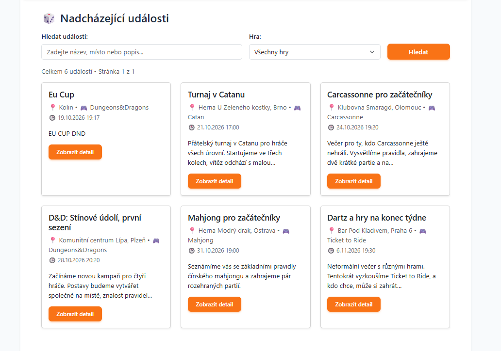
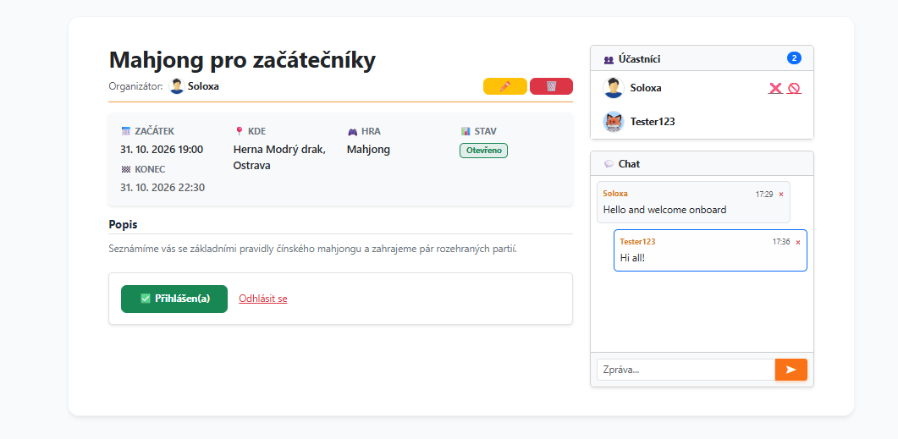
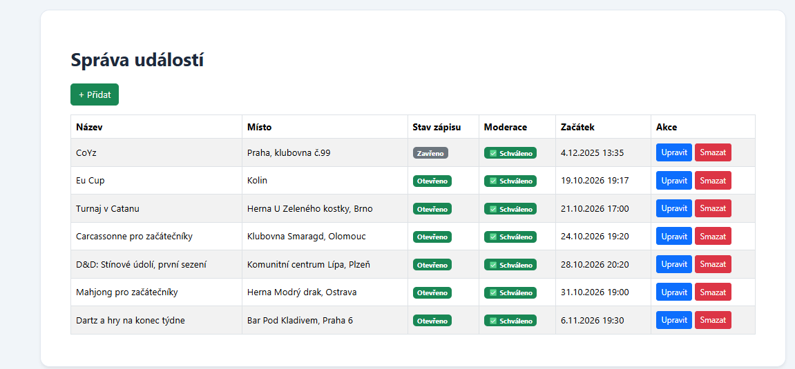

# BoardGame Club

A web application for organizing board game sessions. Users create game events, moderators approve them before they become visible, and participants chat and join sessions.

Originally developed as my graduation project (maturitní odborná práce) at a secondary IT school in Kolín, Czech Republic. The interface is in Czech because the school project required it.

## Screenshots





## Features

- Create and edit game events. Changes to key fields (title, place, date, game, description) send the event back to moderation.
- Game catalog. A new game can be added while creating an event.
- Search and filter upcoming events by keyword and game, with pagination.
- Join and leave events. Organizers can remove or block participants.
- Event chat with message deletion.
- User profile with password change and avatar upload.
- Admin panel for users, events, moderation and search.
- Email notifications through SMTP.

## Roles

| Role | Access |
|---|---|
| Guest | Browses public events only |
| User | Joins and leaves events, uses the chat, edits own profile |
| Organizer | Creates and edits own events; changes go to moderation |
| Moderator | Approves or rejects pending events |
| Admin | Full access, including user management |

## Tech Stack

- PHP 8.2, Nette Framework (Application, Forms, Database, Security, Mail)
- Latte templates, Bootstrap
- MariaDB 10.11
- Docker and Docker Compose

## Getting Started

### Option 1: Docker (recommended)

Requirements: Docker with Compose. On Windows, use Docker Desktop with WSL 2 and run the commands in an Ubuntu (WSL) terminal.

1. Create the local configuration file:

```shell
   cp config/local.neon.dist config/local.neon
```

   In `config/local.neon`, set the database host to `db` (not `127.0.0.1`) and fill in the SMTP settings. This file is excluded from the Docker image and must not be committed.

2. Build and start the containers:

```shell
   docker compose up -d --build
```

3. Import the database schema and sample data:

```shell
   docker compose exec -T db mariadb -uroot -proot mop < data/mysql.sql
```

   The file drops existing tables before creating them. Check that the import worked:

```shell
   docker compose exec db mariadb -uroot -proot mop -e "SHOW TABLES;"
```

   You should see nine tables, including `users`, `events` and `roles`.

4. Open `http://localhost:8080`.

5. Create a user from the command line:

```shell
   docker compose exec -u www-data app php bin/create-user.php <username> <email> <password>
```

   New users get the `user` role. To make a user an admin:

```shell
   docker compose exec db mariadb -uroot -proot mop -e "UPDATE users SET role_id = 1 WHERE username = '<username>';"
```

The root password `root` is for local development only. Do not use it in production.

### Option 2: Without Docker

Requirements: PHP 8.1 or newer, Composer, MariaDB or MySQL.

```shell
composer install
cp config/local.neon.dist config/local.neon
```

1. Set the database connection and SMTP settings in `config/local.neon`.
2. Make `temp/` and `log/` writable by the web server.
3. Import the schema: `mysql -u <user> -p mop < data/mysql.sql`
4. Start the built-in server: `php -S localhost:8000 www/index.php`

## Troubleshooting

**500 error on the home page.** The database is empty. Run the import step and check with `SHOW TABLES;`.

**`Permission denied` for `temp/` or `log/`.** Console commands may have created cache files as root. Fix the owner:

```shell
docker compose exec app chown -R www-data:www-data temp log
```

Run console scripts with `-u www-data` to avoid this.

**`Unable to connect to database`.** Check that `config/local.neon` uses `host=db` when running with Docker.

**`Call to undefined method App\Bootstrap::boot()`.** The `bin/create-user.php` script must use `$container = (new App\Bootstrap)->bootWebApplication();`.

**`version is obsolete` warning.** The `version` line at the top of `docker-compose.yml` is no longer used by Docker Compose. It is safe to remove it.

## Project Structure

- `app/Presentation/` - presenters for the front end and admin panel
- `app/Model/` - facades for users, events, games and mail
- `app/Core/` - shared code: forms, authentication, base presenters
- `config/` - Nette configuration; `local.neon` is not committed
- `data/mysql.sql` - database schema and test data
- `docker-compose.yml`, `Dockerfile` - container setup

## Planned Improvements

- Redesign the interface: responsive layout and modern event cards.
- Game recommendations based on user interests.
- Better chat notifications.
- Mobile-friendly layout.

## My Contribution

I designed and implemented the event lifecycle with moderation, role-based permissions, participant management, the event chat and the admin panel. Authentication is based on the Nette user-authentication example.

## Credits

Authentication is based on the [Nette user-authentication example](https://github.com/nette-examples/user-authentication), licensed under BSD-3-Clause.